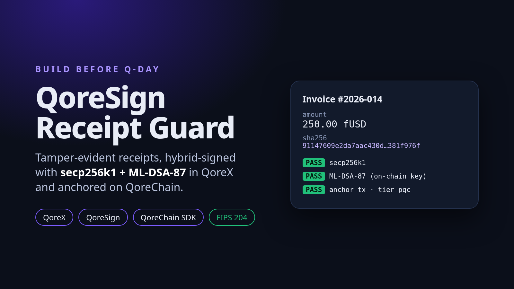

# QoreSign Receipt Guard



**Tamper-evident receipts for freelancers and small shops, signed with secp256k1 + ML-DSA-87 and anchored on QoreChain.**

A receipt or invoice you send today can be forged later: by editing the PDF, or, after Q-Day, by forging an ECDSA signature with a quantum computer. Receipt Guard gives each receipt a fingerprint (SHA-256 of canonical JSON) that is:

1. **hybrid-signed** in the QoreX wallet (`signArbitrary`: ADR-36 secp256k1 **and** ML-DSA-87 / FIPS 204),
2. **anchored on QoreChain** in a hybrid-signed transaction whose memo is `qrg1:<fingerprint>`,
3. packed into a **proof card** (JSON) that anyone can re-check against the public chain.

The verifier checks the ML-DSA-87 half against the key the issuer **registered on chain**, never against a key carried by the card or the page, and it reads the anchor transaction back to confirm its ML-DSA-87 layer was verified by the network (`tier: pqc`).

> Built for **Build Before Q-Day** (#BuildBeforeQDay). Testnet `qorechain-diana` only. Test tokens have no value.

## What it does

| Step | Where | QoreChain tech |
| --- | --- | --- |
| Connect wallet | Web app | QoreX `window.qorex.native.enable/getKey` on `qorechain-diana` |
| Write a receipt | Web app / CLI | canonical JSON + SHA-256 fingerprint, bound to chain + issuer |
| Sign it | QoreX (web) or `qrg issue` (CLI) | QoreSign message-signing-v1: secp256k1 (ADR-36) + ML-DSA-87 over `qorechain-msg-v1\|chainId\|data` |
| Anchor it | QoreX `signAndBroadcast` (web) or `EthNativeSigner` (CLI) | 1-uqor self-send with memo `qrg1:<sha256>`, **hybrid-signed** (`PQCHybridSignature` extension, 4,627-byte ML-DSA-87 signature) |
| Verify it | `POST /api/verify` (server) or `qrg verify` | `verifyMessageWithChain` + `inspectTransaction` from `@qorechain/qoresign/network` |
| Address helper | Web app / `qrg addr` | `qor1…` ⇄ `0x…` (same 20 bytes) |

Verification report checks:

- fingerprint recomputes from the receipt,
- the signed text is bound to this receipt, chain and issuer,
- hybrid signature valid against the **registered** ML-DSA-87 key (and whether the key has a proof of possession),
- the anchor tx exists with code 0,
- its memo carries this fingerprint,
- it was signed by the issuer,
- it carries a **verified** ML-DSA-87 layer (`tier: pqc`).

Edit one character of a receipt and the card fails. Point a card at someone else's transaction and it fails. Strip the post-quantum half and it fails.

## Quick start

Requirements: Node.js 22+, npm.

```bash
npm install
npm test               # 14 offline tests: receipt model, hybrid signatures, hybrid anchor tx
npm run test:live      # 3 read-only tests against the public testnet
npm run dev            # http://localhost:5173
```

### Web app (QoreX)

1. Install the QoreX extension.
2. Turn on Developer mode (tap the version number 7 times) and select **Switch to testnet (diana)**.
3. Get test QOR at <https://dashboard.qorechain.io/faucet>.
4. Run `npm run dev` and open <http://localhost:5173>.
5. Click **Connect QoreX**, then **Sign with QoreX (hybrid)**, then **Anchor fingerprint on QoreChain**, then **Download proof card**.

QoreX registers the account's ML-DSA-87 key on its first transaction.

### CLI (throwaway testnet key)

```bash
npm run cli -- wallet:new        # writes ../testnet-wallet/qrg-testnet.wallet.json (mode 600, outside the repo)
# fund the printed qor1... address at https://dashboard.qorechain.io/faucet
npm run cli -- status
npm run cli -- register          # MsgRegisterPQCKeyV2 + proof of possession (classical-only by design, once)
npm run cli -- issue --title "Invoice #2026-014 - logo design" --amount 250.00 --currency fUSD
npm run cli -- verify proofs/<id>.json
npm run cli -- inspect <txhash>  # any tx: ML-DSA-87 layer, tier, signer
npm run cli -- demo-offline      # no funds needed: sign + verify + tamper demo with local keys
```

Check the anchor yourself:

```bash
curl -s https://api-testnet.qore.host/cosmos/tx/v1beta1/txs/<HASH> | jq '.tx_response.events[] | select(.type=="pqc_hybrid_verify")'
```

You can also open <https://explore.qore.network>, switch to **Testnet**, and search the hash.

## Architecture

```
src/lib/receipt.ts   receipt model, canonical JSON, SHA-256 fingerprint, signing text, anchor memo, address forms
src/lib/proof.ts     proof card + verifier (qoresign verifyMessage / verifyMessageWithChain / inspectTransaction)
src/lib/qorex.ts     QoreX wrapper: enable, getKey, signArbitrary, signAndBroadcast (capability-checked)
src/App.tsx          React UI (scaffolded by create-qorechain-dapp fullstack-web)
vite.config.ts       /lcd proxy to the testnet REST API + POST /api/verify (server-side verification)
scripts/chain.ts     Node: testnet wallet, account reads, PQ key registration, hybrid anchor tx, simulation-based gas
scripts/cli.ts       `npm run cli -- …`
tests/               vitest: receipt.test.ts, hybrid.test.ts, live.test.ts
e2e/                 headless UI smoke test with a mock QoreX provider (`npm run e2e`, needs Chrome)
```

### Security notes

- The page never holds a private key; QoreX makes both signatures.
- The CLI wallet is a **throwaway testnet** key stored outside the repo (`.gitignore` also blocks `*.wallet.json`). The CLI refuses a wallet file not marked `testnet` / `qorechain-diana`.
- ML-DSA-87 verification always uses the key registered on chain (`verifyMessageWithChain`), so a forged card cannot bring its own key.
- The signed text names the app, the chain and the issuer, so a receipt signature cannot be replayed as a login elsewhere.
- Each receipt has a 128-bit random nonce, so identical receipts do not collide.

## Kits used

- `create-qorechain-dapp` 0.14.0 (template `fullstack-web`, `--network testnet`)
- `@qorechain/sdk` 0.14.0: `createClient`, `deriveUnifiedAccount`, `EthNativeSigner` (hybrid), `buildRegisterPqcKeyMsg`, `signProofOfPossession`
- `@qorechain/qoresign` 0.2.0: `signMessage`, `verifyMessage`, `verifyHybridTx`, `verifyMessageWithChain`, `inspectTransaction`, `simulateTx`, `broadcastTx`
- QoreX wallet: `signArbitrary`, `signAndBroadcast`
- `@qorechain/pqc` (through the SDK)

## Testnet address

- Demo issuer (CLI, testnet only): `qor1jx6z8y3zh8x0veuhun6lwcwqfx8st7n9us4z43` (`0x91b4239222B9cCF66797e4F5f761c0498F05FA65`)

## License

MIT, see [LICENSE](LICENSE). The QoreChain SDK and QoreSign packages are Apache-2.0 and belong to their authors.
